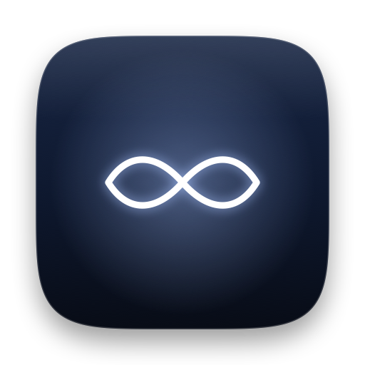

<div align="center">

<picture>
  <source media="(prefers-color-scheme: dark)" srcset="assets/png/icon-dark.png">
  <source media="(prefers-color-scheme: light)" srcset="assets/png/icon.png">
  
</picture>

<br><br>

<picture>
  <source media="(prefers-color-scheme: dark)" srcset="assets/svg/auraloop-wordmark.svg">
  <source media="(prefers-color-scheme: light)" srcset="assets/svg/auraloop-wordmark-dark.svg">
  
</picture>

### High-Performance Native Live Wallpapers & Screensavers for macOS

[](https://apple.com/macos)
[](https://apple.com)
[](#license)
[](LICENSE)
[](https://swift.org)

</div>

---

## Overview

AuraLoop is a native macOS application engineered in Swift and SwiftUI that delivers smooth, looping video wallpapers and screen savers across all connected displays with near-zero CPU and memory footprint. By delegating video decoding directly to macOS hardware media engines, AuraLoop keeps system resource consumption minimal and automatically pauses during fullscreen apps, low power mode, or display sleep.

---

## Key Features

- **Seamless Video Wallpapers** — Smooth, continuous looping on every connected display simultaneously.
- **Lock Screen Support** — Play distinct or synchronized live wallpapers on your macOS lock screen.
- **Screen Saver Engine** — Run high-definition live video as your native macOS screen saver with customizable idle delays.
- **Curated Apple Aerials** — Browse and enjoy Apple's Aerials, Dynamic Wallpapers, and system aerial screen savers in 4K.
- **Hardware-Accelerated Efficiency** — Hardware-decoded HEVC/H.265 playback via AVFoundation ensures virtually zero CPU overhead.
- **Smart Power Management** — Automatically pauses during fullscreen applications, display sleep, low power mode, and battery thresholds.
- **Desktop Awareness** — Option to pause during active work and resume playback when the desktop is revealed.
- **Adaptive Frame Rates** — Switch between native high frame rate and energy-efficient 30 fps per wallpaper.
- **Explore & Preview Catalog** — Fullscreen interactive preview with on-demand download management.
- **Custom Playlists & Automation** — Timed rotations, randomized shuffling, and full 24-hour day/night schedules.
- **Universal Importer** — Drag-and-drop support for custom video files (auto-transcoded to optimized HEVC) and `.saver` bundles.
- **Menu Bar Controller** — Instant playback control, track skipping, and preset selection from the system menu bar.

> **System Requirements**: macOS 14.0 (Sonoma) or newer. Universal binary compiled for Apple Silicon and Intel architectures. Lock screen and screen saver features require macOS 15 / 26+.

---

## Project Structure & Architecture

The codebase follows a strictly organized, modular design:

```
AuraLoop/
├── assets/                          # Static branding and media assets
│   ├── png/                         # High-resolution raster images & app icons
│   │   ├── icon.png
│   │   ├── icon-dark.png
│   │   └── dmg-background.png
│   ├── svg/                         # Scalable vector graphics and wordmarks
│   │   ├── auraloop.svg
│   │   ├── auraloop-dark.svg
│   │   ├── auraloop-wordmark.svg
│   │   └── auraloop-wordmark-dark.svg
│   └── data/                        # Bundled catalog metadata & configurations
│       └── FeaturedWallpapers.json
│
├── AuraLoop/                        # macOS Application Package & Core Modules
│   ├── Package.swift                # Swift Package Manager manifest
│   ├── build-app.sh                 # Production compilation, signing & DMG builder
│   │
│   ├── Icon/                        # macOS iconsets and icon generation
│   │   ├── AuraLoopIcon.icon/       # Asset catalogs for macOS icon compiler (actool)
│   │   ├── InApp/                   # Multi-theme in-app icon variations
│   │   └── AppIcon.icns             # Standalone system application icon
│   │
│   ├── Sources/
│   │   ├── AuraLoopApp/             # Primary SwiftUI application
│   │   │   ├── AuraLoopApp.swift    # Application entry point & lifecycle
│   │   │   ├── Views/               # Screen layouts (Home, Explore, Library, Settings, etc.)
│   │   │   ├── Components/          # Design system, Liquid Glass UI, and controls
│   │   │   ├── Icons/               # Vector glyphs, status symbols, and branding marks
│   │   │   ├── Controllers/         # Menu bar, lock screen, and system observers
│   │   │   └── Models/              # Data stores, playback states, and cache engines
│   │   │
│   │   ├── AuraLoopKit/             # Shared framework & domain logic
│   │   │   ├── Core/                # Versioning, release metadata, and catalog parsers
│   │   │   ├── Aerials/             # Apple aerial catalogs and system store bindings
│   │   │   ├── Library/             # Wallpaper manifest, playlist manager, and importers
│   │   │   ├── Playback/            # Multi-monitor rendering logic and schedule rules
│   │   │   ├── Media/               # Hardware transcoders, thumbnailers, and preview cache
│   │   │   └── Engine/              # Desktop window monitors and hardware playback engine
│   │   │
│   │   ├── AuraLoopWallpaperExtension/ # System wallpaper app extension
│   │   ├── AuraLoopEngine/          # Background helper process
│   │   ├── AuraLoopImport/          # CLI utility for batch importing video files
│   │   ├── AuraLoopSet/             # CLI utility for setting wallpaper/screensaver
│   │   ├── AuraLoopPrepare/         # Video asset optimization and pre-processing
│   │   ├── AuraLoopPublish/         # Cloudflare R2 / CDN catalog publisher
│   │   └── AuraLoopSaverPicture/    # Screensaver capture utility
│   │
│   └── Tests/                       # Comprehensive unit and integration test suite
│       └── AuraLoopKitTests/        # 315+ automated test cases
│
├── LICENSE                          # Proprietary software license
└── README.md                        # Documentation
```

---

## Development & Build Guide (Authorized / Internal Only)

> **Notice**: This software is **Proprietary & Closed Source**. Public or unauthorized compilation, redistribution, cloning, or usage is strictly forbidden. The instructions below are provided exclusively for authorized maintainers.

### Prerequisites

- macOS 14.0 or newer
- Xcode 15+ / Command Line Tools with Swift 5.9+

### Build & Run Tests

```bash
cd AuraLoop
swift build
swift test
```

### Packaging Application & Installer DMG

```bash
cd AuraLoop
./build-app.sh
./build-app.sh --dmg
```

The compiled application bundle will be created at `AuraLoop/dist/AuraLoop.app` and the standalone installer at `AuraLoop/dist/AuraLoop-*.dmg`.

---

## License

**Copyright © 2026 Avdesh Jadon. All Rights Reserved.**

This software is strictly **Proprietary and Confidential**. All source code, design, artwork, trademarks, and associated materials are the exclusive property of Avdesh Jadon.

- **No Unauthorized Use**: Unauthorized copying, running, distribution, installation, or execution of this software—whether locally, on a server, or in any other environment—is strictly prohibited without prior express written permission from the copyright owner.
- **No Commercial Use**: Commercial exploitation, redistribution, sale, or sublicensing is strictly forbidden.
- **No Derivative Works**: Modification, adaptation, decompilation, or reverse engineering of any part of this software is prohibited.

For licensing inquiries or written authorization, please contact [Avdesh Jadon](https://github.com/avdeshjadon).
